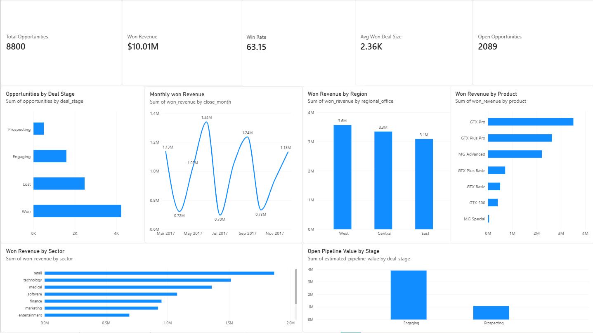
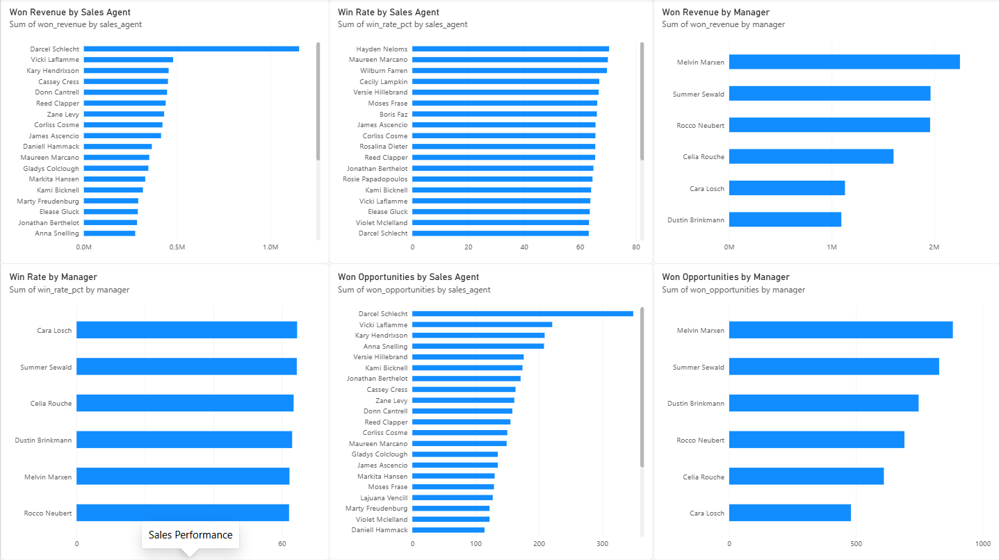
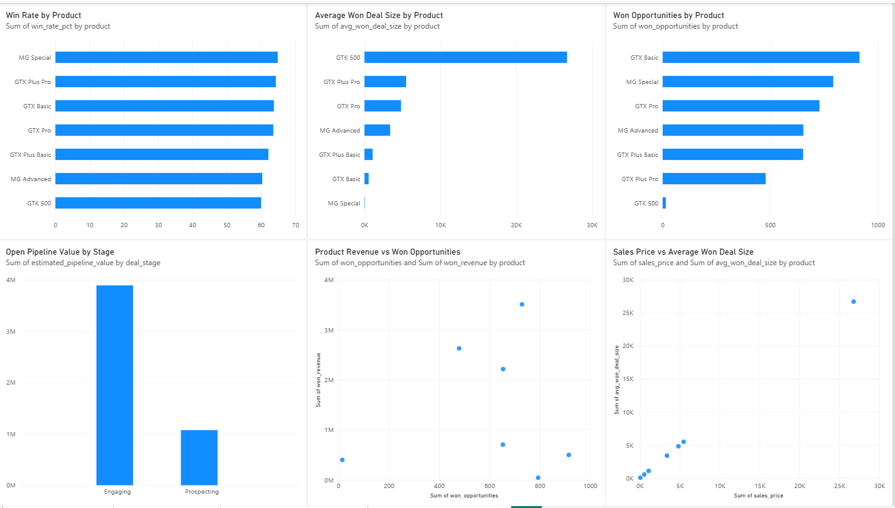
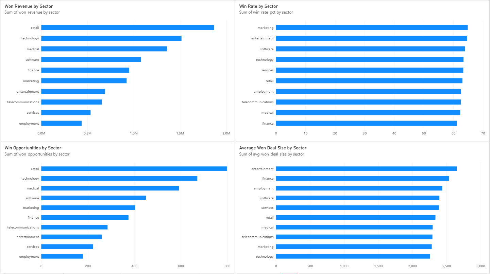

# CRM Sales Opportunities Analytics

## Project Overview

An end-to-end sales analytics project built using **SQL, DuckDB, Python, and Power BI** to analyze CRM sales opportunities, understand sales performance, evaluate product and regional trends, and identify open pipeline value.

The project transforms raw CRM data into an analytical dataset and an interactive **4-page Power BI dashboard** designed around practical sales and business questions.

## Business Objective

The analysis focuses on answering questions such as:

* How many sales opportunities are currently in the pipeline?
* What is the overall win rate?
* How much revenue has been generated from won deals?
* Which products and regions generate the most revenue?
* How do sales agents and managers perform?
* How large is the current open pipeline?
* Which products have higher average deal values?
* How does product pricing relate to won deal size?
* How does sales performance vary across customer sectors?

## Dataset

The project uses four CRM datasets:

* **Accounts** — customer account information, sector, revenue, employees, and location
* **Products** — product names, product series, and standard sales prices
* **Sales Pipeline** — sales opportunities, stages, dates, and deal values
* **Sales Teams** — sales agents, managers, and regional offices

### Data grain

| Dataset        | Grain                   |
| -------------- | ----------------------- |
| Accounts       | One row per account     |
| Products       | One row per product     |
| Sales Pipeline | One row per opportunity |
| Sales Teams    | One row per sales agent |

## Data Preparation

Data was loaded into **DuckDB** using Python and transformed through SQL.

Key cleaning steps included:

* Standardized inconsistent product naming (`GTXPro` → `GTX Pro`)
* Corrected sector spelling (`technolgy` → `technology`)
* Corrected location spelling (`Philipines` → `Philippines`)
* Checked duplicate business keys
* Validated referential integrity across tables
* Validated numeric fields and date ranges
* Investigated missing values by sales stage
* Created analytical flags for won, lost, and open opportunities
* Calculated sales cycle duration for completed opportunities

Missing values in open opportunities were retained where they were logically expected rather than being artificially imputed.

## Analytical Dataset

The final analytical dataset combines:

* Opportunity information
* Sales agent and manager information
* Regional information
* Account attributes
* Product attributes
* Deal stage and value
* Won/lost/open indicators
* Sales cycle duration

This dataset was used as the foundation for the SQL analysis and Power BI reporting layer.

## Key Metrics

| Metric                |     Result |
| --------------------- | ---------: |
| Total Opportunities   |      8,800 |
| Won Revenue           |    $10.01M |
| Win Rate*             |     63.15% |
| Average Won Deal Size |  $2,360.91 |
| Open Opportunities    |      2,089 |
| Open Pipeline Value** |     $4.97M |
| Average Sales Cycle   | 47.99 days |

* Win rate is calculated as Won / (Won + Lost), excluding opportunities that are still open.

** Open pipeline value is estimated using the standard product sales price because open opportunities do not have a realized close value.

## Power BI Dashboard

### Dashboard Preview

#### Executive Overview


#### Sales Performance


#### Product & Pipeline Analysis


#### Account & Market Analysis


The Power BI dashboard contains four analytical pages.

### 1. Executive Overview

Provides a high-level view of sales performance through:

* KPI cards
* Opportunities by deal stage
* Monthly won revenue
* Won revenue by region
* Won revenue by product
* Won revenue by sector
* Open pipeline value by stage

### 2. Sales Performance

Analyzes performance across the sales organization:

* Won revenue by sales agent
* Win rate by sales agent
* Won revenue by manager
* Win rate by manager
* Won opportunities by sales agent
* Won opportunities by manager

### 3. Product & Pipeline Analysis

Evaluates product-level sales performance and pipeline:

* Win rate by product
* Won opportunities by product
* Average won deal size by product
* Open pipeline value by stage
* Product revenue vs. won opportunities
* Sales price vs. average won deal size

### 4. Account & Market Analysis

Examines performance across customer sectors:

* Won revenue by sector
* Win rate by sector
* Won opportunities by sector
* Average won deal size by sector

## Selected Findings

### Sales performance

The dataset contains **8,800 opportunities**, of which **4,238 were won** and **2,473 were lost**. A further **2,089 opportunities remain open**.

### Revenue

Won opportunities generated approximately **$10.01M** in realized revenue.

The **West region** generated the highest won revenue at approximately **$3.57M**, followed by Central and East.

### Products

**GTX Pro** generated the highest won revenue at approximately **$3.51M**.

**GTX Plus Pro** had the highest average won deal size among the major products at approximately **$5.49K**.

### Pipeline

The current open pipeline contains **2,089 opportunities** with an estimated value of approximately **$4.97M**.

Engaging opportunities represent the larger share of the open pipeline by value.

### Sales cycle

Completed opportunities have an average sales cycle of approximately **48 days**.

## SQL Analysis

SQL scripts were created for:

* Executive KPI analysis
* Sales funnel analysis
* Monthly revenue
* Regional performance
* Product performance
* Sector performance
* Sales agent performance
* Manager performance
* Open pipeline analysis

## Tools & Technologies

* **SQL**
* **DuckDB**
* **Python**
* **Power BI**
* **CSV**
* **Git / GitHub**

## Project Structure

```text
CRM+Sales+Opportunities/
│
├── accounts.csv
├── products.csv
├── sales_pipeline.csv
├── sales_teams.csv
├── data_dictionary.csv
│
├── crm_sales.duckdb
├── setup_duckdb.py
│
├── clean_accounts.sql
├── clean_sales_pipeline.sql
├── analytics_opportunities.sql
├── executive_kpis.sql
├── kpi_summary.sql
├── funnel_analysis.sql
├── sales_funnel.sql
├── monthly_revenue.sql
├── regional_performance.sql
├── product_performance.sql
├── sector_performance.sql
├── sales_agent_performance.sql
├── manager_performance.sql
└── open_pipeline.sql
│
└── power-bi/
    ├── crm_sales.duckdb
    ├── export_powerbi_data.py
    │
    └── powerbi_data/
        ├── CRM_Sales_Opportunities_Dashboard.pbix
        ├── kpi_summary.csv
        ├── sales_funnel.csv
        ├── monthly_revenue.csv
        ├── regional_performance.csv
        ├── product_performance.csv
        ├── sector_performance.csv
        ├── sales_agent_performance.csv
        ├── manager_performance.csv
        └── open_pipeline.csv
```

## Outcome

This project demonstrates an end-to-end analytics workflow:

**Raw CRM Data → Data Quality Checks → SQL Transformation → Business Analysis → Power BI Dashboard**

The project emphasizes practical business questions, data validation, analytical reasoning, and communicating sales insights through interactive reporting.
